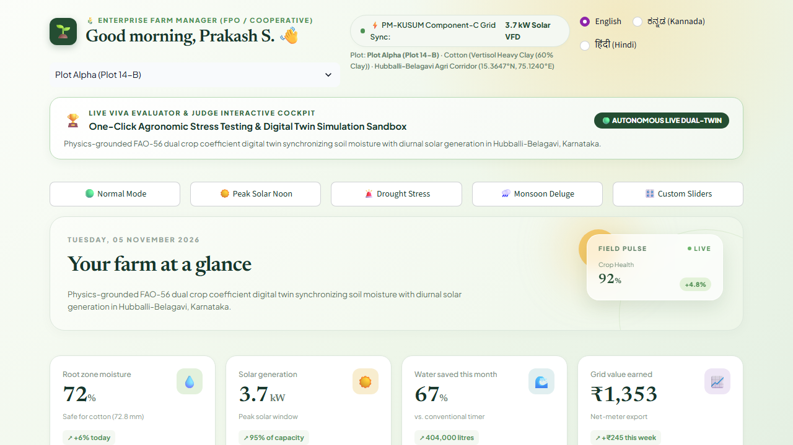
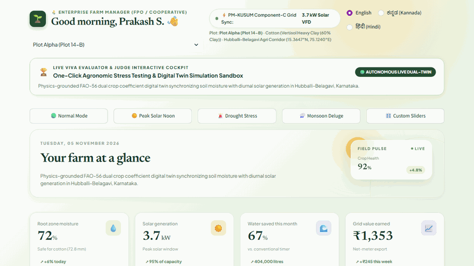

# SuryaJal™ (ಸೂರ್ಯಜಲ)
### Solar-Aware Precision Agronomic Digital Twin & Multimodal Gemini AI Copilot
**KLE Technological University, Hubballi | Hack Vally 2026 | Team Quantum Cosmic**

[](https://www.python.org/downloads/)
[](https://streamlit.io/)
[](https://ai.google.dev/)
[](https://www.fao.org/land-water/databases-and-software/cropwat/en/)
[](./cache/)

---

## 📸 Preview & Live Walkthrough





> 🎬 **[Watch Full Demo Video (WebM)](./docs/demo.webm)**

---

## 🌾 The Core Problem
Across the Hubballi-Belagavi agricultural corridor in North Karnataka, farmers face a triple crisis:
1. **Unpredictable Midnight Grid Shifts:** HESCOM supplies 3-phase agricultural power during erratic midnight shifts (11 PM - 5 AM), forcing farmers into dangerous nocturnal field trips.
2. **Severe Over-Irrigation & Waterlogging:** Conventional flood irrigation pumps over 140 mm of water weekly, wasting millions of liters of groundwater and suffocating roots in Vertisol black cotton clay soils.
3. **Under-Utilized Solar Infrastructure:** PM-KUSUM 5 HP solar pumps frequently sit idle during peak sunlight hours or pump blindly without root-zone physics.
4. **Fake AI & Language Barriers:** Common vision apps hallucinate soil metrics on irrelevant screenshots and output complex English text unreachable to rural Kannada/Hindi speakers.

---

## ☀️ The SuryaJal™ Solution
**SuryaJal™** is a physics-grounded agronomic digital twin that pairs real-time solar irradiance modeling with FAO-56 dual crop coefficient hydrology, Google Gemini 2.5 Flash multimodal computer vision, Indic voice synthesis, and five live demonstrable engineering engines.

```
                      [ Open-Meteo & SoilGrids APIs ]
                                    │
                                    ▼
                    [ 1-D FAO-56 Soil Moisture Twin ]
                                    │
                                    ▼
                  [ Multi-Objective Solar-Aware ML Controller ]
                                    │
         ┌──────────────────────────┼──────────────────────────┐
         ▼                          ▼                          ▼
[ 5 Live Engineering Engines ]  [ Gemini 2.5 Multimodal ]  [ Indic Voice Agent ]
• Solar Energy Arbitrage        • Rejects Code Screenshots • ಕನ್ನಡ (Kannada)
• Variable Rate Irrigation      • Real Botanical Health    • हिंदी (Hindi)
• Disease Predictor (Mills)     • Grounded Telemetry Copilot• English Audio
• Aquifer Recharge (USDA NRCS)
• 3D Hydrology Matrix
```

---

## 🔬 5 Live Demonstrable Engineering Engines
1. **Solar Energy Arbitrage Engine:** Dynamic financial yield optimization comparing the marginal value of irrigation water ($\approx ₹6.40/\text{m}^3$) against net-metering solar export to HESCOM ($₹3.25/\text{kWh}$). Automatically sells power when soil moisture is safe.
2. **Variable Rate Irrigation (VRI) Micro-Zone Optimization:** Calculates discrete pulse duty cycles and soak times across Vertisol clay ($5\text{ mm/hr}$ infiltration), alluvial loam ($18\text{ mm/hr}$), and sandy loam ($45\text{ mm/hr}$) to eliminate waterlogging.
3. **Micro-Climate Crop Disease Predictor:** Evaluates Leaf Wetness Duration (LWD) and modified Mills infection indices to forecast fungal outbreaks and time preventive bio-fungicide spraying before rain wash-off.
4. **Predictive Groundwater Recharge Model:** Uses USDA NRCS Runoff Curve Number $Q$ to route monsoon storm runoff into percolation borewell shafts, projecting aquifer water table rise.
5. **24h Solar Dispatch Gantt & 3D Subsurface Hydrology Matrix:** Visualizes root-zone hydration layers ($0-20\text{ cm}$, $20-60\text{ cm}$, $60-120\text{ cm}$) synchronized with hourly solar generation.

---

## 🤖 Multimodal AI & Indic Voice
- **Gemini 2.5 Flash Multimodal Vision Scout:** Detects genuine crops vs non-agricultural screenshots (e.g. laptop IDE screens), displaying honest alerts rather than generating fake soil readings.
- **Live Grounded Agronomic Co-Pilot:** Real-time conversational agent with live telemetry state injection and full site navigation capabilities.
- **Trilingual Voice Output:** Instant audio generation in Kannada (ಕನ್ನಡ), Hindi (हिंदी), and English using `gTTS` base64 streaming.

---

## 🚀 Quick Start & Live Demo
```powershell
# Navigate to repository
cd Y:\GenAI\suryajal

# Activate virtual environment
.\venv\Scripts\activate

# Launch the Full-Width Desktop Application
streamlit run app.py --server.port 8501
```

Access the interface in your browser:
- **Live Application:** `http://localhost:8501`

---

## 🧪 Testing Suite
```powershell
cd Y:\GenAI\suryajal
.\venv\Scripts\python.exe test_apptest.py
```
*Validated with 0 runtime exceptions on the latest build.*
